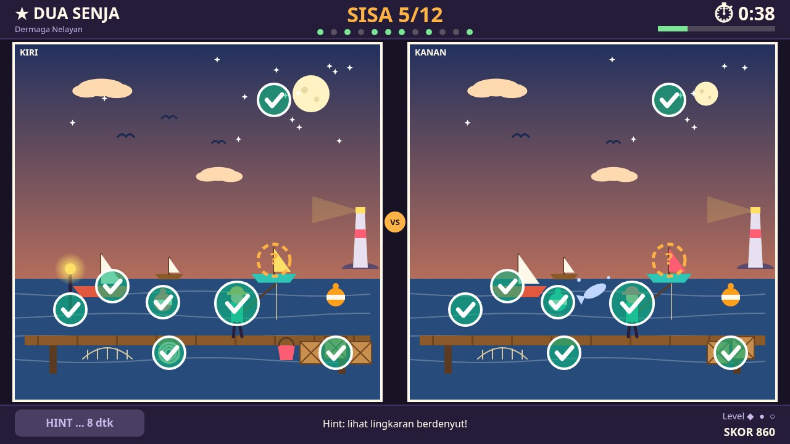

[](https://make.fun/bounty/best-spot-the-difference-game-20261121-0451?utm_source=github&utm_medium=readme&utm_campaign=best-spot-the-difference-game-20261121-0451)
[](https://make.fun/bounty/best-spot-the-difference-game-20261121-0451/leaderboard?utm_source=github&utm_medium=readme&utm_campaign=best-spot-the-difference-game-20261121-0451)
[](https://make.fun/bounty/best-spot-the-difference-game-20261121-0451?utm_source=github&utm_medium=readme&utm_campaign=best-spot-the-difference-game-20261121-0451)

Built for the [make.fun best-spot-the-difference-game-20261121-0451 bounty](https://make.fun/bounty/best-spot-the-difference-game-20261121-0451) — a complete spot-the-difference game, $50 shared by the 10 best.

# Dua Senja — Spot the Difference



Cari selisih di dua gambar yang hampir sama. Tiga senja, tiga tempat:
**Warung Kopi Senja** (10 selisih), **Dermaga Nelayan** (12 selisih), dan
**Lapangan Layang-Layang** (12 selisih). Semua gambar digambar prosedural di
canvas — tanpa file gambar, tanpa network, tanpa library.

## Main

- Klik selisihnya di gambar **kiri atau kanan** — lingkaran hijau + centang menandai yang sudah ketemu.
- **SISA x/y** di atas layar menghitung yang belum ketemu; titik-titik di bawahnya menunjukkan satu per satu.
- **H** = hint (−50 poin, lingkaran berdenyut 3 detik, maks 3 per level).
- **R** = ulang level · **Esc** = jeda · **M** = bisu.
- Salah klik: −5 detik dan kombo reset. Ketemu beruntun menaikkan kombo (+10 per langkah).
- Selesaikan level sebelum timer habis untuk bonus waktu (+5/detik) dan bintang 1–3.

## Jalankan

```sh
node serve.ts        # http://localhost:8080
```

Buka `game/index.html` langsung juga bisa — game ini file statis murni, tanpa
build step dan tanpa request network apa pun.

## Screenshot

Screenshot dibuat dari kode game sendiri lewat `shots.json` (mode `?shot=`):
`1-cover.jpg` (Level 2, 7 ketemu, hint aktif, timer 0:38), `2-warung.jpg` (Level 1, 6 ketemu, timer 0:38),
`3-layang.jpg` (Level 3, 10 ketemu), `4-selesai.jpg` (Level 1 selesai, overlay terang).

## Struktur

- `game/src/config.js` — semua angka tuning & warna
- `game/src/scenes.js` — definisi 3 scene + 34 selisih (dengan zona klik)
- `game/src/painter.js` — menggambar scene ke panel
- `game/src/state.js` — aturan main (murni, bisa diuji dari Node)
- `game/src/input.js` — mouse + keyboard
- `game/src/audio.js` — bunyi WebAudio, tanpa file audio
- `game/src/render.js` — HUD, penanda (cakram hijau isi penuh + centang putih, terbaca sampai 300px), layar menu/menang/kalah
- `game/src/shots.js` — staging screenshot deterministik
- `game/src/main.js` — boot + loop 60 Hz
- `main.ts` — hand-in: menyalin `game/` + `screenshots/` ke `/output`, menulis `dossier.json`

## Lisensi

MIT — lihat `LICENSE`.
